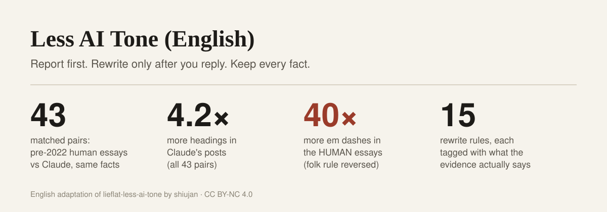

# Less AI Tone (English)

English | [中文](README.zh.md)



**An Agent Skill for cleaning AI tone out of finished English prose, built on the method of [lieflat-less-ai-tone](https://github.com/larashero3-dotcom/lieflat-less-ai-tone) and checked against 43 matched pairs of human and Claude essays.** It reports what it found, quotes your draft, says how strong the evidence is for each pattern, and proposes specific edits. It rewrites only after you reply, then runs a second check and shows the changes.

## Credit

This project is an adaptation of **[lieflat-less-ai-tone](https://github.com/larashero3-dotcom/lieflat-less-ai-tone) by shiujan**, a Chinese writing skill built from two rounds of measurement (629 articles, then 270 same-topic, same-facts pairs and about 500,000 model judgments). From that project come:

- the workflow: detect → report → wait for the user → minimal rewrite → recheck;
- the grading system (A mechanical, B suggested, C report only, H human review, X never touch, F model fingerprint);
- the three-layer split between scripts, closed-criteria model judgments and human review;
- the four semantic checks (renaming, cohesion chains, conclusion colons, isomorphic triples) and their thresholds;
- the central lesson that "AI tells" must survive a *paired* comparison, and that the ones that reverse go on a never-touch list.

The English rules, word lists, detection scripts, calibration tooling and the English measurements are new. If this is useful to you, please star and cite the original too. Both projects are licensed CC BY-NC 4.0.

## What the calibration measured

The original's key move was pairing: compare each AI article with a human article on the same topic, using the same facts, so topic differences don't masquerade as style differences. This port repeats that on a small scale.

| Side | What | Scope |
|---|---|---|
| Human | Blog essays published before ChatGPT (2000–2021) by Joel Spolsky, Dan Luu, Julia Evans, Jeff Atwood, Patrick McKenzie, Ben Kuhn, Paul Graham and Derek Sivers | 43 essays, first ~1200 words each |
| AI | One helper wrote a neutral outline and fact list of each essay; a separate Claude (Opus 5.5) writer, which never saw the original wording, wrote a post of matching length | 43 essays, length ratio 0.97 |
| Test | Per-file densities from `detect.py`, two-sided sign test across pairs | 27 measures |

What held up, and what didn't:

| Pattern | Human | Claude | Pairs where Claude had more / less | Verdict |
|---|---|---|---|---|
| Headings per 1000 words | 1.6 | 6.8 | 43 / 0 | Claude much more |
| Section-length variation | 0.63 | 0.38 | 2 / 11 | Claude sections more even |
| "It's not X, it's Y" reframes | 0.10 | 0.28 | 10 / 2 | Claude more |
| Bold inside running prose | 0 | 0.59 | 7 / 0 | Claude more |
| Em dashes | 2.62 | 0.07 | 1 / 31 | **humans more** |
| Passive voice | 4.25 | 2.77 | 13 / 30 | **humans more** |
| "delve", "pivotal", "underscore"… | 0.30 | 0.11 | 4 / 11 | no difference |
| "Let's dive in", ", highlighting…", "I hope this helps" | ~0 | ~0 | < 6 pairs differ | too rare to judge |

Two folk rules point the wrong way here: the human essays had far more em dashes, and more passive voice (which matches Reinhart et al., *PNAS* 2025). "Fixing" either one makes this kind of writing *more* like Claude's. So passive voice is on the never-touch list, and dash density is reported as a per-writer, per-model habit, never as evidence of AI.

**Limits.** One model, one genre (programmer blogs), 43 pairs, professional writers on the human side. The Claude essays were written inside an agent harness whose instructions may suppress some habits; GPT has not been measured yet. Full table and method: [RESEARCH.md](./RESEARCH.md). The essays are copyrighted and not redistributed; the fetch, outline and calibration scripts are in [calibration/](./calibration/) so you can rerun the test on writing you're allowed to use.

## How the skill works

1. **Detect.** `scripts/detect.py` counts 15 rule patterns, punctuation fingerprints and structure measures, and extracts candidates for four semantic checks that the conversation model labels against closed criteria in [references/semantic-criteria.md](./references/semantic-criteria.md).
2. **Report before editing.** A readable report with the draft's counts, the evidence tag and measured reference for each rule, quoted passages, proposed edits, and what it will leave alone. A pattern being more common in AI text across a corpus is not a significance test on your draft, and never a claim about who wrote it.
3. **Wait for a reply.** "Go ahead" accepts the proposal; one sentence adjusts the scope. Nothing is rewritten before that.
4. **Rewrite and recheck.** Smallest accepted changes, facts and hedges preserved, structure untouched; detection runs again and `scripts/report.py` produces a before/after Markdown report with changes marked. Never-touch counts must not move.

Rules and boundaries are in [SKILL.md](./SKILL.md); grades in [DETECT.md](./DETECT.md); a worked example in [examples/](./examples/).

## Install and try it

Ask an AI assistant that supports Agent Skills to install **less-ai-tone-en** from this repository, or use:

```bash
npx skills add Rambo-Li/less-ai-tone-en
```

Or copy the folder into your skills directory (`~/.claude/skills/`, `~/.codex/skills/`, `~/.agents/skills/` …). Needs Python 3, standard library only.

Then give your assistant a finished English article (300+ words) and ask it to remove AI tone.

## Calibrate on your own writing

```bash
python scripts/calibrate.py --human my-old-posts/ --ai ai-versions/ --paired
```

Put each human piece and its AI counterpart (same topic and facts, same file name) in the two folders. Add `--write` to make `detect.py` show your numbers. To add a model, see [calibration/generate.py](./calibration/generate.py).

**Files** [SKILL.md](./SKILL.md) · [DETECT.md](./DETECT.md) · [RESEARCH.md](./RESEARCH.md) · [scripts/](./scripts/) · [calibration/](./calibration/) · [中文 README](./README.zh.md)

**License** [CC BY-NC 4.0](./LICENSE) · adapted from [lieflat-less-ai-tone](https://github.com/larashero3-dotcom/lieflat-less-ai-tone) © 2026 shiujan
