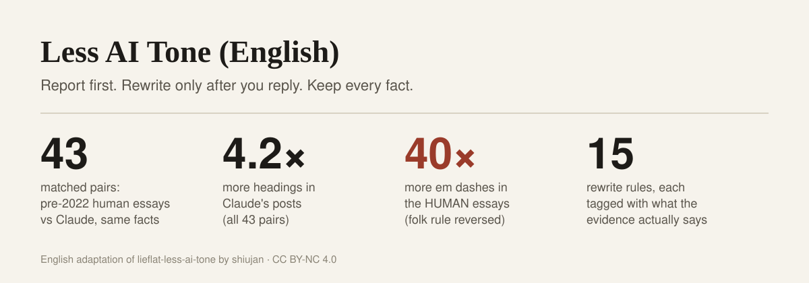

# Less AI Tone（英文版）

[English](README.md) | 中文



**一个给英文成稿去 AI 味的 Agent Skill。方法来自 [lieflat-less-ai-tone（去AI味）](https://github.com/larashero3-dotcom/lieflat-less-ai-tone)，并用 43 组人类与 Claude 的同题配对文章做了校准。** 它先报告发现了什么，引用你的原句，说明每条特征的证据强度，并给出具体改法。收到你的回复后才改写，改完再测一遍，给出前后对比。

## 致谢

本项目改编自 **shiujan 的 [lieflat-less-ai-tone](https://github.com/larashero3-dotcom/lieflat-less-ai-tone)**。原项目是中文写作 skill，基于两轮实测（629 篇对照，以及 270 组同题同事实配对和约 50 万次模型判断）。以下内容来自原项目：

- 工作流：检测 → 报告 → 等用户回复 → 最小改写 → 复测；
- 分级体系（A 机械改 / B 建议改 / C 只报告 / H 人审 / X 永不改 / F 模型指纹）；
- 脚本、封闭判据的模型判读、人工审读三层分工；
- 四项语义层检查（同义重命名、衔接连环、结论冒号、同构三连）及其门槛；
- 核心经验：“AI 味特征”必须经过**配对**对比的检验，方向反转的一律进永不改清单。

英文规则、词表、检测脚本、校准工具和英文实测数据是新做的。如果这个项目对你有用，也请给原项目点星、注明出处。两个项目都采用 CC BY-NC 4.0 许可。

## 校准测了什么

原项目最关键的一步是配对：每篇 AI 文章都对应一篇同题、同事实的人类文章，避免把话题差异误当成文风差异。本项目小规模复做了这一步。

| 一侧 | 内容 | 规模 |
|---|---|---|
| 人类 | ChatGPT 出现前（2000–2021）的博客文章，作者有 Joel Spolsky、Dan Luu、Julia Evans、Jeff Atwood、Patrick McKenzie、Ben Kuhn、Paul Graham、Derek Sivers | 43 篇，每篇取前约 1200 词 |
| AI | 一个助手为每篇文章写中性大纲和事实清单；另一个从未见过原文措辞的 Claude（Opus 5.5）按大纲写出等长文章 | 43 篇，长度比 0.97 |
| 检验 | `detect.py` 逐篇计密度，对配对做双侧符号检验 | 27 项指标 |

结果：

| 特征 | 人类 | Claude | Claude 更多 / 更少的组数 | 结论 |
|---|---|---|---|---|
| 每千词小标题数 | 1.6 | 6.8 | 43 / 0 | Claude 多得多 |
| 小节长度参差 | 0.63 | 0.38 | 2 / 11 | Claude 小节更均匀 |
| “不是 X，而是 Y”式翻案 | 0.10 | 0.28 | 10 / 2 | Claude 更多 |
| 正文中加粗 | 0 | 0.59 | 7 / 0 | Claude 更多 |
| 破折号 | 2.62 | 0.07 | 1 / 31 | **人类更多** |
| 被动语态 | 4.25 | 2.77 | 13 / 30 | **人类更多** |
| delve、pivotal、underscore 等词 | 0.30 | 0.11 | 4 / 11 | 无差异 |
| “Let's dive in”、“, highlighting…”、“I hope this helps” | ≈0 | ≈0 | 有差异的不足 6 组 | 太少，无法判断 |

有两条流行说法在这里方向相反：人类文章的破折号多得多，被动语态也更多（与 Reinhart 等人 2025 年发表在 *PNAS* 的结论一致）。“修掉”这两项，反而让这类文章更像 Claude 写的。所以被动语态列入永不改清单，破折号只作为因人、因模型而异的习惯报告，从不当作 AI 的证据。

**局限。** 只测了一个模型、一种文体（程序员博客）、43 组，人类一侧是职业写作者。Claude 文章是在 agent 环境里写的，环境指令可能压制了部分习惯；GPT 还没测。完整表格和方法见 [RESEARCH.md](./RESEARCH.md)。语料有版权，不随仓库分发；抓取、大纲和校准脚本在 [calibration/](./calibration/)，可以在你有权使用的文章上复跑。

## 怎么用

1. **检测。** `scripts/detect.py` 统计 15 条规则、标点指纹和结构指标，并抽出四类语义层候选，由对话中的模型按 [references/semantic-criteria.md](./references/semantic-criteria.md) 的封闭判据判读。
2. **先报告，不改稿。** 报告列出本篇计数、每条规则的证据标签和实测参照、原文例句、建议改法和不改的部分。某特征在语料中 AI 更常用，不等于对你这篇做了显著性检验，更不能据此判断作者。
3. **等你回复。** 回复“go ahead”即按建议改；一句话也可以调整范围。回复之前不动原文。
4. **改写并复测。** 只做接受的最小改动，保留事实和限定语，不动结构；再跑一次检测，`scripts/report.py` 生成标出改动的 Markdown 前后对比报告。永不改项的计数不得变化。

规则与边界见 [SKILL.md](./SKILL.md)，分级见 [DETECT.md](./DETECT.md)，示例见 [examples/](./examples/)。

## 安装

让支持 Agent Skills 的 AI 助手从本仓库安装 **less-ai-tone-en**，或运行：

```bash
npx skills add Rambo-Li/less-ai-tone-en
```

也可以直接把文件夹复制到 skills 目录（`~/.claude/skills/`、`~/.codex/skills/`、`~/.agents/skills/` 等）。需要 Python 3，只用标准库。

然后把一篇写完的英文文章（300 词以上）交给助手，让它去 AI 味。中文文章请用[原项目](https://github.com/larashero3-dotcom/lieflat-less-ai-tone)。

**许可** [CC BY-NC 4.0](./LICENSE) · 改编自 [lieflat-less-ai-tone](https://github.com/larashero3-dotcom/lieflat-less-ai-tone) © 2026 shiujan
